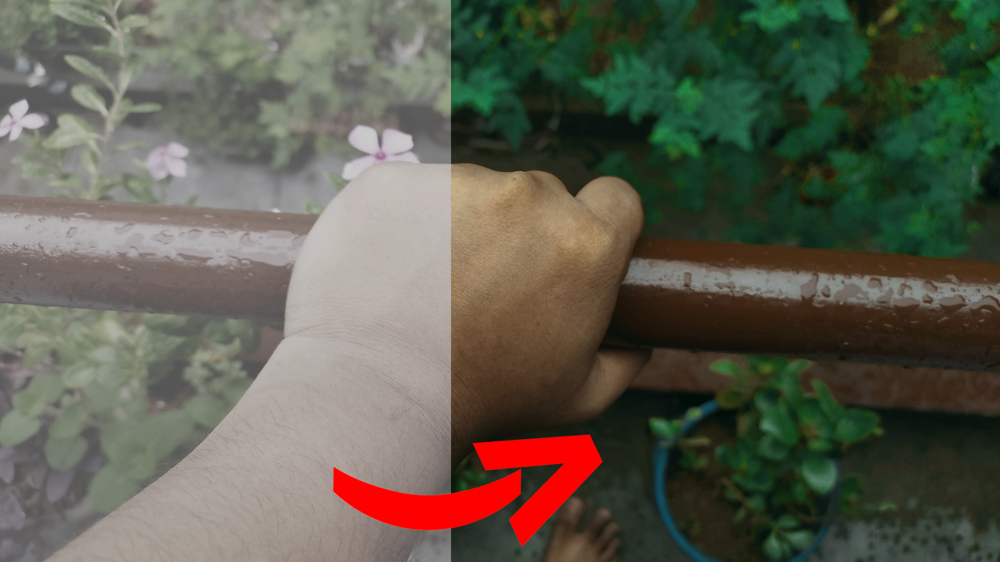

# Open Source LUTs

</img>

These luts are made by Tanishq Pal and are given to the open source community under the CC0-V1-Universal License with full of happyness.

These contains some technical luts as well as creative luts, Depending on the feel / mood the creators can pick any of them and feel free to use them in their projects.

The luts were made with natron and [xlutmaker](https://github.com/darkyboys/xlutmaker) by darkyboys on github (Tanishq Pal) and the source code / project is in the `src/` directory. Along with all the images tested on it. All the images inside this repository were also captured / made by Tanishq Pal and are freely available under the same CC0 - V1 - Universal License.

Please checkout the LICENSE File for more information.

## For Contributions
If you want to contribute then make sure to submit your work only. Which you are willing to upload under the CC0 - v1 - universal license as everything in this repository must be under that license as well as no reference images from other person is allowed unless they are willing to upload them under CC0 - v1 - uniserval as well (You should have the permits).

If you follow those simple rules then you can happily make a pull request :)

Refusing to follow the rules will result in the rejection of the pull request.

---

Thanks a lot for reading.
Have a nice time!
